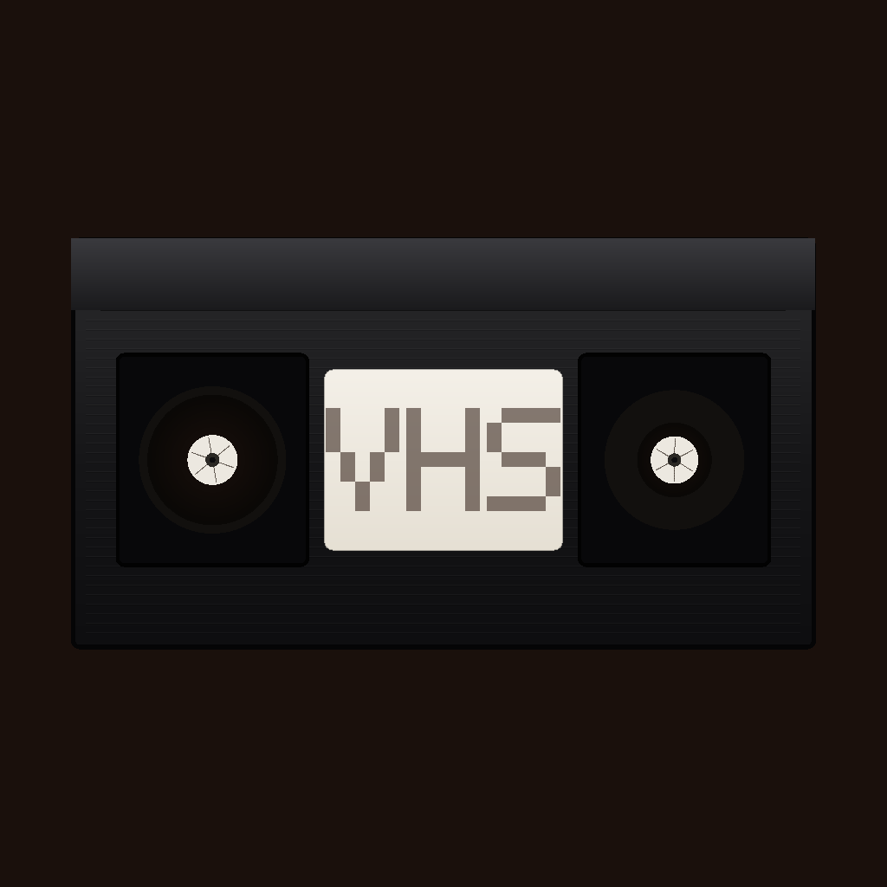
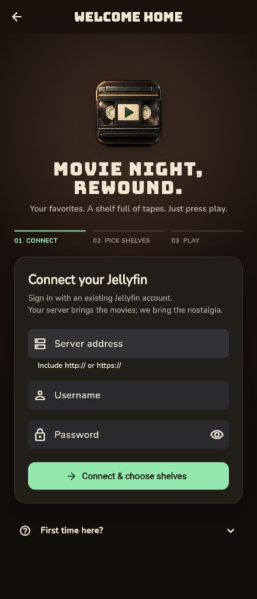
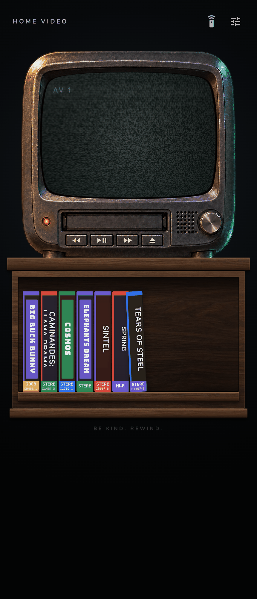

<p align="center">
  
</p>
<h1 align="center">VHSFin</h1>
<p align="center"><strong>Movie night, rewound.</strong><br>A small Jellyfin client with a VHS player interface.</p>
<p align="center">
  <a href="LICENSE"></a>
  
  
</p>
<p align="center"><a href="#get-started">Get started</a> · <a href="#what-it-does">Take a look</a> · <a href="#self-host-the-web-app">Self-host</a> · <a href="CONTRIBUTING.md">Contribute</a></p>


VHSFin is a small, family-friendly client for a Jellyfin server. It presents movies and shows as tapes on a shelf, with a simple player interface inspired by a living-room VCR.

Pick a tape, let it slide into the deck, and press play.

The artwork above is project artwork; the screenshots below show the app. VHSFin is an independent project, not an official Jellyfin client. It includes no media, subscriptions, or hosted service.

## What it does

| VHS-style interface | Useful details |
| --- | --- |
| VHS spines on flat charcoal or walnut shelves | Choose libraries and folders for each shelf |
| A 3D cassette that flies from the shelf into the deck, with mechanical sounds | Movies, series, and an episode picker |
| Six photographic TV cabinets | Change the shelf and TV in Settings |
| CRT glass and scanlines | A clean fullscreen player |
| A remote with rewind and fast-forward | Optional saved positions when you eject a tape |
| VHS sleeve art where available | Jellyfin artwork and procedural fallbacks |

<p align="center">
  
  
</p>

## Get started

VHSFin is currently installed from source. Bring a running Jellyfin server and an existing account. There are no official store releases yet.

1. Download or clone this repository and open its folder.
2. Install [Flutter](https://docs.flutter.dev/get-started/install) with Dart **3.13.2 or later, below 4.0** (see `pubspec.yaml`).
3. Fetch dependencies and choose a device:

```sh
flutter pub get
flutter doctor
flutter devices
flutter run -d chrome
```

For Android, iOS, or macOS, use the device ID printed by `flutter devices`:

```sh
flutter run -d <device-id>
```

| Platform | Development requirements |
| --- | --- |
| Android | Android SDK and an emulator or a device with USB debugging |
| Web | A supported browser; Chrome for Flutter development |
| iOS | macOS, Xcode, and a simulator or a signed device build |
| macOS | macOS and Xcode |

### Set up movie night

1. Tap the empty shelf to **connect**. Enter the server’s base address, username, and password. Passwordless Jellyfin accounts are supported.
2. **Choose shelves.** Check a library, or open it to select a folder. Tap **Done** to return to the living room. Shelf selections are saved separately for each server and account.
3. Let VHSFin look for sleeve art, or continue while it works in the background.
4. Tap a movie to preview its sleeve, then **Insert tape**. Tap a show to choose an episode. Use **Full** for fullscreen and **Eject** to return the tape.

**Setting up for kids?** Use a Jellyfin account with access only to the appropriate libraries. Shelf selection changes what is displayed; Jellyfin’s account permissions provide the access control.

**Missing titles?** VHS-only is enabled by default. In **Settings**, turn it off to show titles that don’t have matching VHS sleeve art.

The late-90s TV/VCR on flat charcoal shelves is the default look. **Settings → SHELF** switches to walnut, and **Settings → TV** offers five more cabinets. Existing saved choices are preserved.

## Self-host the web app

The included Python server serves the release build and proxies cover-art lookups that otherwise run into browser CORS restrictions:

```sh
make web                 # build and serve on port 8080
# Or choose a different port:
make web PORT=8090
```

To try the app without a server, `make demo` stocks the shelf with Blender open movies streamed from Wikimedia Commons.

Open `http://localhost:8080` on the host machine, or its LAN address on another device. The helper binds to all network interfaces for LAN use. Ctrl-C stops it. `make help` lists the available commands.

Use a matching setup: an HTTPS app needs an HTTPS Jellyfin server. For a home HTTP server, run the app over HTTP on your trusted LAN, or configure HTTPS for both. A public HTTPS deployment cannot bypass browser mixed-content or local-network restrictions.

To host the static app yourself:

```sh
flutter build web --release
# Publish the contents of build/web with your web server.
```

The Python helper is intended for a trusted home network. Use an appropriately configured web server/reverse proxy for public hosting. Static hosting alone does not provide the cover-art proxy.

## Build it

```sh
flutter build apk --release       # build/app/outputs/flutter-apk/app-release.apk
flutter build web --release      # build/web
flutter build ios                # macOS; configure signing in Xcode
flutter build macos              # macOS
```

Android release builds currently use the debug signing configuration for easy local installation. Configure your own signing key before distributing a production release or building a store bundle. iOS signing and device provisioning are also your responsibility.

## When the picture needs tuning

| Symptom | What to check |
| --- | --- |
| Can’t connect | Use a full `http://` or `https://` base address, including the port when needed. Keep reverse-proxy prefixes such as `/jellyfin`; omit `/web/#/home`. |
| Works at home, fails elsewhere | Make sure your device can reach the server through your configured network or VPN. |
| Browser blocks the connection | Check HTTPS/HTTP compatibility, server CORS, and browser local-network permissions. |
| iOS rejects an HTTP server | Prefer HTTPS; the project does not add a blanket transport-security exception. |
| A shelf seems empty | Disable VHS-only in Settings, and check the account’s library permissions. |
| Wrong sleeve art | Inspect the tape and reject the mismatched sleeve; external lookups are best effort. |
| Playback won’t start | Check Jellyfin’s playback/transcoding settings and the device’s supported codecs. |

## Data and artwork

Your password is sent to your Jellyfin server for authentication and is not persisted by VHSFin. A session token is saved in local app preferences (browser storage on web), so treat a signed-in device as having access to that account. This storage is not an encrypted credential vault. Sign out on shared devices, and revoke sessions from Jellyfin when needed.

Cover lookup may send title/year searches to Internet Archive and VHSCollector. Artwork is cached locally; availability and matching vary. Google Fonts may fetch fonts when they are not cached. Third-party cover art belongs to its respective rights holders and is not included in the project’s license.

The original VHSFin icon concepts and movie-night illustration were generated for this project. Source images, prompts, and platform export instructions live in [assets/branding](assets/branding/README.md). Mechanical sound credits are in [assets/sounds/CREDITS.txt](assets/sounds/CREDITS.txt).

## Development

```sh
flutter analyze
flutter test
flutter build web --release
```

CI runs analysis, tests, and a web release build. The code is organized by feature, with Riverpod in state/coordinator layers and ordinary Flutter widgets for views. See the [contribution guide](CONTRIBUTING.md) for architecture and local checks.

The focus is deliberately small: libraries, shelves, movies, shows, and playback. Downloads, music, live TV, casting, and multi-server navigation are outside the current scope.

## License

[PolyForm Noncommercial 1.0.0](LICENSE). Personal and other noncommercial use, self-hosting, and contribution are welcome. Commercial use — including listing builds on app stores for sale or other commercial purposes — needs a separate license from the copyright holders.

This is **not** an OSI open-source license. Built with [Flutter](https://flutter.dev) for [Jellyfin](https://jellyfin.org).
